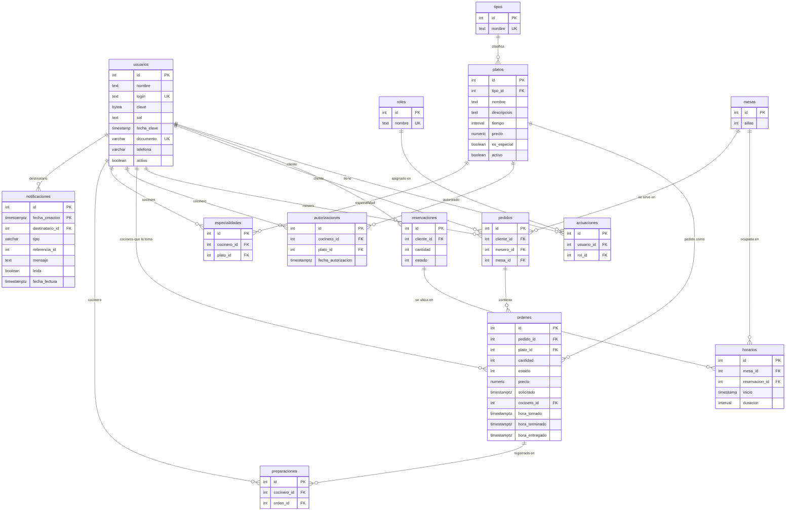

# Insumo para la documentación — Proyecto Restaurante

> **Para quien redacte la documentación (Claude for Docs):** este archivo reúne
> toda la información técnica del proyecto, verificada contra la base de datos
> instalada y las pruebas ejecutadas el 2026-11-08. Úsalo como fuente única para
> escribir el **documento de entrega** que pide el enunciado (sección 7.2):
> diseño de la base de datos, casos de uso, tablespaces, particiones y consultas
> SQL, incluyendo diagrama ER y diccionario de datos.
>
> - Público del documento final: el docente (Ing. Ricardo Naranjo Faccini, MSc)
>   y los evaluadores de la asignatura. Lenguaje técnico, en español.
> - El documento se evalúa por: normalización y uso de claves/restricciones
>   (30 %), scripts y consultas (30 %), claridad de la documentación y del
>   diagrama ER (20 %).
> - Lo que está marcado con **[COMPLETAR]** no se puede saber desde el código y
>   lo debe aportar el estudiante (nombres de los integrantes, imagen del
>   diagrama ER oficial, etc.). No lo inventes.
> - Los fragmentos SQL de este archivo son copias reales del código; puedes
>   citarlos tal cual.

---

## 1. Datos generales

| Campo | Valor |
|---|---|
| Universidad | Pontificia Universidad Javeriana — Facultad de Ingeniería — Departamento de Ingeniería de Sistemas |
| Asignatura | Bases de datos: Administración y Aplicaciones |
| Docente | Ing. Ricardo Naranjo Faccini, MSc |
| Proyecto | Proyecto Restaurante (2026-3) |
| Integrantes | **[COMPLETAR]** |
| Repositorio | https://github.com/JuanDGarridoR/Proyecto-Restaurante---AdBD |
| Motor | PostgreSQL 13 o superior (probado en PostgreSQL 17) |
| Aplicación | PHP 8 sin frameworks, extensión `pgsql` |
| Fecha de entrega (enunciado) | 2026-10-09 |

**Objetivo:** base de datos para un restaurante que gestiona mesas,
reservaciones, menú, pedidos y entregas, garantizando que no se supere el cupo
de mesas, que no se crucen las reservaciones, que a los cocineros solo se les
asignen los platos que saben preparar y que los meseros registren y gestionen
los pedidos.

**Principio de diseño:** las reglas del enunciado se validan **en la base de
datos** (restricciones `CHECK`, llaves, triggers y funciones), no solo en la
aplicación. Si alguien modifica los datos directamente con SQL, las reglas se
siguen cumpliendo. La aplicación PHP es una interfaz sobre esas reglas.

---

## 2. Matriz de cumplimiento del enunciado

Estado verificado el 2026-11-08 sobre una instalación limpia.

| # | Requisito del enunciado | Estado | Dónde se cumple |
|---|---|---|---|
| 2.1 | Administrador: gestionar mesas, menú y empleados | Cumple | Pantallas *Mesas y cupo*, *Menú del restaurante*, *Empleados y usuarios* |
| 2.1 | Registrar usuarios (maitres, meseros, cocineros) y asignar platos a cocineros | Cumple | *Empleados y usuarios* + *Platos autorizados a cocineros*; tabla `autorizaciones`, trigger `trg_autorizacion_valida` |
| 2.1 | Reportes de ventas, reservaciones y pedidos | Cumple | Funciones `reporte_*`, vista materializada `vm_ventas_diarias` |
| 2.2 | Maitre: crear, cancelar y modificar reservaciones; asignar mesas por disponibilidad | Cumple | *Gestionar reservaciones*; `fn_mesas_disponibles()` |
| 2.2 | No superar el cupo ni cruzar reservaciones | Cumple | `fn_validar_reservacion()` + triggers de restricción diferibles |
| 2.3 | Mesero: registrar pedidos por mesa, actualizar estado, gestionar entregas | Cumple | *Registrar pedido*, *Pedidos y entregas*; triggers `trg_pedido_mesero`, `trg_orden_estado` |
| 2.4 | Cocinero: ver pedidos ordenados por tiempo de preparación (más demorados primero), solo platos que sabe preparar; marcar «listo» | Cumple | `cola_cocinero()`, `tomar_orden()`, `marcar_orden_preparada()` |
| 2.5 | Cliente: interacción indirecta | Cumple | Los clientes no inician sesión; reservan vía maitre y piden vía mesero |
| 3.1 | Mesas con identificador y asientos; cupo total = suma de asientos | Cumple | `CHECK (sillas > 0)`, `fn_cupo_total()`, `v_cupo_restaurante` |
| 3.2 | Reservaciones sin cruces en la misma mesa, sin superar el cupo (2 h por reserva), validar disponibilidad | Cumple | `fn_validar_reservacion()`, índice GiST sobre `tsrange`, `fn_ocupacion()` |
| 3.3 | Menú: nombre, descripción, precio, tiempo, categoría; agregar/modificar/eliminar | Cumple | Tablas `platos` y `tipos`; `CHECK` de precio y tiempo; retiro lógico (`activo`) |
| 3.4 | Pedidos asociados a mesa y cliente, varios ítems, estados | Cumple | `pedidos` + `ordenes`; `trg_pedido_mesero`, `trg_orden_nueva` |
| 3.5 | Notificar al mesero pedido listo; actualizar a «entregado» | Cumple | `trg_check_pedido_listo`, `trg_check_pedido_entregado` |
| 3.6 | Reportes de reservaciones y ventas por día/semana/mes; platos más pedidos | Cumple | `reporte_reservaciones()`, `reporte_ventas_periodo()`, `reporte_items_mas_solicitados()` |
| 4.1 | Notificaciones a mesero (pedido listo) y maitre (reserva próxima) | Cumple | Tabla `notificaciones`, `fn_notificar_reservas_proximas(30)` |
| 4.2 | Gestión de empleados | Cumple | *Empleados y usuarios*: crear, modificar, varios roles, desactivar, cambiar clave |
| 4.3 | Historial de reservaciones y pedidos por cliente | Cumple | `historial_cliente_resumen()`, `historial_cliente_timeline()` |
| 4.4 | Validación de cupo al asignar mesas | Cumple | `fn_validar_reservacion()` |
| 4.5 | Interfaz por rol | Cumple | Inicio de sesión y tablero por rol; permisos por opción |
| 5 | Usar el diagrama ER obligatorio | Cumple (se conserva y se extiende) | Ver sección 4.2 |
| 6.1 | PostgreSQL | Cumple | — |
| 6.1 | Al menos 2 tablespaces en directorios distintos | Cumple | `ts_restaurante_actual`, `ts_restaurante_historico` (`sql/tablespaces.sql`) |
| 6.1 | Tabla particionada por fechas que use los tablespaces | Cumple | `notificaciones` por `RANGE (fecha_creacion)` (`sql/migracion_particiones.sql`) |
| 6.2 | Usar la plantilla y la solución del parcial del docente | Cumple | Se parte de `restaurante.sql`/`restaurante_llena.sql` y del código PHP del docente (ver 3.3) |
| 6.3 | Integridad: PK, FK, CHECK, triggers | Cumple | Sección 6 |
| 6.4 | Documentar diseño (ER, diccionario) y consultas | Este documento | — |
| 6.5 | Pruebas | Cumple | 5 scripts `sql/pruebas_*.sql`, 48 verificaciones automáticas en verde |
| 7.1 | Scripts de creación, restricciones, datos de prueba y consultas por caso de uso | Cumple | Carpeta `sql/` (sección 12) |

### Correcciones hechas durante la revisión del 2026-11-08

Conviene mencionarlas como parte del proceso de verificación:

1. **Faltaban los tablespaces y la partición** (requisito 6.1). Se agregaron
   `sql/tablespaces.sql`, `sql/migracion_particiones.sql` y
   `sql/pruebas_particiones.sql`, y se integraron en `sql/instalar.sql`.
2. **Faltaba `CHECK (cantidad > 0)`** en `ordenes` y `reservaciones`. Está en
   el script original del docente (`restaurante.sql`), pero el volcado
   `restaurante_llena.sql` no lo trae. Se restableció en
   `migracion_integridad.sql` (`ck_ordenes_cantidad`, `ck_reservaciones_cantidad`).
3. **Dos scripts de prueba fallaban** (`pruebas_cocineros.sql`,
   `pruebas_notificaciones.sql`). Creaban pedidos sin mesa y marcaban platos
   como preparados sin que un cocinero los tomara, algo que las reglas nuevas
   ya no permiten. Se corrigieron, y la de notificaciones ahora termina en
   `ROLLBACK`.
4. La pantalla de empleados mostraba avisos de PHP 8 con campos vacíos. Se corrigió.
5. Se reforzó la interfaz por rol: cada usuario solo ve las opciones que su rol
   puede usar, y el servidor rechaza las demás aunque se escriban en la URL.

---

## 3. Arquitectura

### 3.1 Componentes

```
Navegador ──HTTP──> index.php (enrutador)
                       │  ?opcion=X  →  fn_X($conn)
                       │  control de sesión y permisos por rol (lib/sesion.php)
                       ▼
                  lib/*.php (módulos)  ──pg_query_params──>  PostgreSQL "restaurante"
                                                              (reglas en triggers y funciones)
```

- `index.php`: enrutador. Lee `?opcion=X`, verifica la sesión y que el rol
  pueda usar la opción (`sesion_puede()`), y llama a `fn_X($conn)`.
- `esqueleto.html` + `css/estilo.css`: plantilla y estilos.
- La aplicación se conecta con el rol de base de datos `estudiante`, que tiene
  permisos de lectura y escritura pero **no es dueño de las tablas**. No puede
  desactivar triggers ni cambiar la estructura.

### 3.2 Módulos PHP

| Archivo | Responsabilidad |
|---|---|
| `lib/sesion.php` | Inicio de sesión (`fn_autenticar` en la BD), permisos por rol, cambio de clave, mensajes |
| `lib/restaurante.php` | Tablero por rol, carta del restaurante, selección de mesa para pedidos (código base del docente) |
| `lib/nuevas.php` | Mesas: agregar, modificar, eliminar; cupo; búsqueda de platos por precio |
| `lib/menu.php` | Menú y categorías: agregar, modificar, retirar platos |
| `lib/empleados.php` | Empleados y usuarios (roles, clave, activo); registro rápido de clientes |
| `lib/reservaciones.php` | Reservaciones, disponibilidad de mesas y ocupación |
| `lib/pedidos.php` | Registro de pedidos, lista de pedidos, entregas |
| `lib/cocina.php` | Autorizaciones de cocina y cola del cocinero |
| `lib/notificaciones.php` | Widget de notificaciones con actualización automática (AJAX) |
| `lib/reportes.php` | Reportes con gráficas y exportación CSV; historial de clientes |
| `lib/libreria.php` | Conexión y utilidades del docente |

### 3.3 Relación con la plantilla del docente

- **Base de datos:** se parte del esquema del docente (`sql/restaurante.sql`,
  12 tablas) y de su volcado con datos (`sql/restaurante_llena.sql`). Ninguna
  tabla original se elimina ni se renombra. Las migraciones solo **agregan**
  columnas, restricciones, tablas, funciones y triggers, y son idempotentes
  (se pueden ejecutar varias veces).
- **Aplicación:** se conserva la estructura del docente: `index.php` como
  enrutador `?opcion=X → fn_X`, `esqueleto.html`, `lib/libreria.php`
  (`pg_conectar`, `procesar_query`) y las funciones `fn_*` originales
  (`fn_desplegar_menu`, `fn_realizar_pedidos`, `fn_ver_mesas`, ...), que
  siguen funcionando.

### 3.4 Roles de la aplicación y opciones visibles

Cada opción declara qué roles pueden usarla. El Administrador puede usarlas
todas. Una opción no permitida no aparece en el menú, y si se pide por URL el
servidor responde "Su rol no tiene permiso para usar esta opción".

| Rol | Opciones |
|---|---|
| Administrador | Todas: mesas y cupo, menú, empleados, autorizaciones de cocina, reportes, historial, más las de los demás roles |
| Maitre / Recepcionista | Gestionar reservaciones, registrar cliente, notificaciones (reservas próximas), historial de clientes |
| Mesero | Registrar pedido, pedidos y entregas, registrar cliente, notificaciones (pedidos listos) |
| Cocinero (y Chef) | Mi cola de preparación (tomar plato, marcar preparado) |
| Gerente | Reportes y estadísticas, historial de clientes |
| Todos | Ver la carta, platos por precio, cambiar mi clave, salir |

Usuarios de prueba (clave = `clave_<usuario>_2026`):

| Usuario | Nombre | Roles |
|---|---|---|
| ana | Ana Torres | Administrador |
| valentina | Valentina Rojas | Maitre, Recepcionista |
| carlos | Carlos Mendoza | Mesero |
| laura | Laura Gomez | Mesero |
| diego | Diego Castro | Mesero |
| sofia | Sofia Martinez | Cocinero, Chef |
| miguel | Miguel Rodriguez | Cocinero |
| mariana | Mariana Lopez | Cocinero |
| andres | Andres Perez | Gerente |
| — | Julian Herrera | Cliente (no inicia sesión) |

---

## 4. Modelo de datos

### 4.1 Diagrama entidad-relación (modelo implementado)

**[COMPLETAR]:** el enunciado exige usar el diagrama ER que aparece como
imagen en la página 4 del PDF del enunciado. Inserta esa imagen como
"diagrama obligatorio" y presenta el siguiente como "modelo implementado",
que conserva todas sus entidades y agrega las indicadas.



### 4.2 Diferencias con el diagrama obligatorio del docente

Tablas del docente que se **conservan sin cambios de nombre**: `usuarios`,
`roles`, `actuaciones`, `mesas`, `tipos`, `platos`, `especialidades`,
`reservaciones`, `horarios`, `pedidos`, `ordenes`, `preparaciones`.

Extensiones:

| Tabla | Cambio | Motivo |
|---|---|---|
| `usuarios` | + `login`, `sal`, `documento`, `telefono`, `activo` | Inicio de sesión con clave en hash, gestión de empleados, búsqueda de clientes, desactivar sin borrar historial |
| `platos` | + `es_especial`, `activo` | Platos especiales solo para Chef; retiro lógico de platos ya pedidos |
| `pedidos` | + `mesa_id` | Requisito 3.4: el pedido se asocia a una mesa |
| `ordenes` | + `cocinero_id`, `hora_tomado`, `hora_terminado`, `hora_entregado`, `precio` | Quién prepara cada plato, tiempos de cada estado, precio congelado al pedir |
| `autorizaciones` (nueva) | Relación N:M cocinero–plato con fecha y unicidad | Requisito 2.1: platos que cada cocinero sabe preparar. Reemplaza funcionalmente a `especialidades` (sus datos se migraron), que se conserva por compatibilidad con la plantilla |
| `notificaciones` (nueva) | Avisos a meseros y maitres; particionada por fecha | Requisito 4.1 y requisito técnico de partición |

`especialidades` y `preparaciones` son tablas originales del docente. Se
conservan y se mantienen sincronizadas: `migracion_cocineros.sql` copió
`especialidades` a `autorizaciones`, y `tomar_orden()` sigue insertando en
`preparaciones`. La fuente de verdad pasa a ser `autorizaciones` y
`ordenes.cocinero_id`, que incluyen las restricciones (unicidad, fecha,
validación de rol). Conviene explicarlo así en el documento.

### 4.3 Códigos de estado

| Tabla.columna | Valor | Significado |
|---|---|---|
| `ordenes.estado` | 1 | En preparación (estado inicial obligatorio) |
| | 2 | Preparado («listo») — lo marca el cocinero que tomó el plato |
| | 3 | Entregado — lo marca el mesero; solo desde 2 |
| `reservaciones.estado` | 0 | Cancelada (no ocupa mesa ni cupo) |
| | 1 | Activa |
| | 2 | Cumplida |
| | 3 | No asistió |
| `notificaciones.tipo` | `PEDIDO_LISTO` | Para el mesero que registró el pedido |
| | `RESERVA_PROXIMA` | Para todos los maitres/recepcionistas |

El estado de un **pedido** no se almacena. Se calcula en la vista `v_pedidos`
como el estado del plato menos avanzado (`MIN(ordenes.estado)`). Así se evita
redundancia: un pedido está «listo» cuando todos sus platos lo están.

### 4.4 Normalización

- **1FN:** todos los atributos son atómicos. Los roles de un usuario se
  modelan con la tabla `actuaciones`, no con listas en una columna, y los
  platos de un pedido con `ordenes`.
- **2FN:** todas las tablas tienen llave primaria simple (`id`), salvo
  `notificaciones` (`id, fecha_creacion`, exigida por la partición). En esta
  última los atributos dependen de `id`, que por sí solo es único (secuencia),
  así que no hay dependencias parciales.
- **3FN:** no hay dependencias transitivas. La categoría del plato está en
  `tipos`, los roles en `roles` y el cupo se calcula (`fn_cupo_total()`), no se
  guarda.
- **Desnormalización controlada:** `ordenes.precio` copia el precio del plato
  **al momento del pedido**. No es redundancia, sino un dato histórico: si el
  precio del menú cambia después, las ventas pasadas no deben cambiar. Lo
  asigna el trigger `trg_orden_nueva`.
- **Relaciones N:M** resueltas con tablas puente: usuarios–roles
  (`actuaciones`), cocineros–platos (`autorizaciones`), reservaciones–mesas
  (`horarios`, que permite que una reserva grande use varias mesas).

---

## 5. Diccionario de datos

Generado desde el catálogo de la base instalada. PK = llave primaria,
FK = llave foránea, UK = única.

### usuarios — personas del sistema (empleados y clientes)
| Columna | Tipo | Nulo | Defecto | Descripción / restricciones |
|---|---|---|---|---|
| id | integer | NO | serial | PK |
| nombre | text | NO | | Nombre completo |
| login | text | SÍ | | Usuario de ingreso; UK sin distinguir mayúsculas (`uq_usuarios_login` sobre `lower(login)`). Solo los empleados tienen |
| clave | bytea | SÍ | | `sha256(sal ‖ clave)`; nunca en texto plano |
| sal | text | SÍ | | Sal aleatoria (UUID) por usuario, nueva en cada cambio de clave |
| fecha_clave | timestamp | SÍ | | Último cambio de clave |
| documento | varchar(50) | SÍ | | UK cuando no es nulo (`uq_usuarios_documento`) |
| telefono | varchar(30) | SÍ | | |
| activo | boolean | NO | true | Un usuario inactivo no puede iniciar sesión; se conserva su historial |

### roles — catálogo de roles
| Columna | Tipo | Nulo | Descripción |
|---|---|---|---|
| id | integer | NO | PK |
| nombre | text | NO | UK (`uq_roles_nombre`). Valores: Administrador, Mesero, Cocinero, Gerente, Recepcionista, Maitre, Chef, Cliente |

### actuaciones — roles de cada usuario (N:M)
| Columna | Tipo | Nulo | Descripción |
|---|---|---|---|
| id | integer | NO | PK |
| rol_id | integer | NO | FK → roles(id) |
| usuario_id | integer | NO | FK → usuarios(id) |
| | | | UK (usuario_id, rol_id). Trigger `trg_actuacion_eliminada` |

### mesas
| Columna | Tipo | Nulo | Descripción |
|---|---|---|---|
| id | integer | NO | PK (identificador único de la mesa) |
| sillas | integer | NO | `CHECK (sillas > 0)`. Constraint trigger `trg_mesa_sillas`: no se pueden quitar sillas si dejan una reserva sin espacio |

### tipos — categorías del menú
| Columna | Tipo | Nulo | Descripción |
|---|---|---|---|
| id | integer | NO | PK |
| nombre | text | NO | UK. Valores: Entrada, Plato fuerte, Postre, Bebida, Ensalada |

### platos — ítems del menú
| Columna | Tipo | Nulo | Defecto | Descripción |
|---|---|---|---|---|
| id | integer | NO | serial | PK |
| tipo_id | integer | NO | | FK → tipos(id) (categoría) |
| nombre | text | NO | | Único entre los platos activos (`uq_platos_nombre_activo` sobre `lower(nombre) WHERE activo`) |
| descripcion | text | SÍ | | |
| tiempo | interval | NO | | Tiempo de preparación; `CHECK (tiempo > 0)` |
| precio | numeric | NO | | `CHECK (precio > 0)` |
| es_especial | boolean | NO | false | Solo se autoriza a cocineros con rol Chef |
| activo | boolean | NO | true | `false` = retirado del menú (los platos ya pedidos no se borran) |

### especialidades — (plantilla del docente) cocinero–plato
| Columna | Tipo | Nulo | Descripción |
|---|---|---|---|
| id | integer | NO | PK |
| cocinero_id | integer | SÍ | FK → usuarios(id) |
| plato_id | integer | SÍ | FK → platos(id) |

### autorizaciones — platos que cada cocinero sabe preparar
| Columna | Tipo | Nulo | Defecto | Descripción |
|---|---|---|---|---|
| id | integer | NO | serial | PK |
| cocinero_id | integer | NO | | FK → usuarios(id) ON DELETE CASCADE |
| plato_id | integer | NO | | FK → platos(id) ON DELETE CASCADE |
| fecha_autorizacion | timestamptz | NO | now | |
| | | | | UK (cocinero_id, plato_id). Trigger `trg_autorizacion_valida` |

### reservaciones
| Columna | Tipo | Nulo | Defecto | Descripción |
|---|---|---|---|---|
| id | integer | NO | serial | PK |
| cliente_id | integer | NO | | FK → usuarios(id) |
| cantidad | integer | NO | | Personas; `CHECK (cantidad > 0)` |
| estado | integer | NO | 1 | `CHECK (estado IN (0,1,2,3))`. Constraint trigger `trg_reservacion_valida` |

### horarios — mesa(s) y franja de cada reservación
| Columna | Tipo | Nulo | Defecto | Descripción |
|---|---|---|---|---|
| id | integer | NO | serial | PK |
| mesa_id | integer | NO | | FK → mesas(id) |
| reservacion_id | integer | NO | | FK → reservaciones(id) |
| inicio | timestamp | NO | | Inicio de la reserva |
| duracion | interval | NO | 2 horas | `CHECK (duracion > 0)`. Ocupación estimada (requisito: 2 h) |
| | | | | Índice GiST `idx_horarios_rango` sobre `tsrange(inicio, inicio+duracion, '[)')`. Constraint trigger `trg_horario_valido` |

### pedidos
| Columna | Tipo | Nulo | Descripción |
|---|---|---|---|
| id | integer | NO | PK |
| cliente_id | integer | SÍ* | FK → usuarios(id). *Obligatorio por trigger `trg_pedido_mesero` |
| mesero_id | integer | SÍ* | FK → usuarios(id). *Obligatorio y con rol Mesero (trigger) |
| mesa_id | integer | SÍ* | FK → mesas(id). *Obligatorio al crear (trigger) |

(Las columnas aceptan nulo en el esquema heredado; la obligatoriedad la impone
el trigger para no romper los datos históricos de la plantilla.)

### ordenes — platos de cada pedido
| Columna | Tipo | Nulo | Defecto | Descripción |
|---|---|---|---|---|
| id | integer | NO | serial | PK |
| plato_id | integer | NO | | FK → platos(id) |
| pedido_id | integer | NO | | FK → pedidos(id) |
| estado | integer | NO | 1 | `CHECK (estado IN (1,2,3))` |
| cantidad | integer | NO | | `CHECK (cantidad > 0)` |
| solicitado | timestamptz | NO | now | Momento del pedido |
| cocinero_id | integer | SÍ | | FK → usuarios(id); cocinero que tomó el plato |
| hora_tomado | timestamptz | SÍ | | |
| hora_terminado | timestamptz | SÍ | | Se asigna al pasar a Preparado |
| hora_entregado | timestamptz | SÍ | | Se asigna al pasar a Entregado |
| precio | numeric | SÍ | | Precio congelado al pedir; `CHECK (precio IS NULL OR precio >= 0)` |
| | | | | Triggers: `trg_orden_nueva`, `trg_orden_estado`, `trg_check_autorizacion_cocinero`, `trg_check_pedido_listo`, `trg_check_pedido_entregado` |

### preparaciones — (plantilla del docente) registro cocinero–orden
| Columna | Tipo | Nulo | Descripción |
|---|---|---|---|
| id | integer | NO | PK |
| cocinero_id | integer | SÍ | FK → usuarios(id) |
| orden_id | integer | SÍ | FK → ordenes(id) |

### notificaciones — avisos (tabla particionada)
| Columna | Tipo | Nulo | Defecto | Descripción |
|---|---|---|---|---|
| id | integer | NO | secuencia | Parte de la PK |
| fecha_creacion | timestamptz | NO | now | Parte de la PK; **llave de partición** |
| destinatario_id | integer | NO | | FK → usuarios(id) ON DELETE CASCADE |
| tipo | varchar(50) | NO | | `CHECK (tipo IN ('PEDIDO_LISTO','RESERVA_PROXIMA'))` |
| referencia_id | integer | NO | | Id del pedido o de la reservación |
| mensaje | text | NO | | |
| leida | boolean | NO | false | |
| fecha_lectura | timestamptz | SÍ | | |
| | | | | PK (id, fecha_creacion). Unicidad (tipo, referencia_id, destinatario_id) con el trigger `trg_notificacion_unica` |

### Vistas
| Vista | Tipo | Contenido |
|---|---|---|
| `v_cupo_restaurante` | vista | Número de mesas y cupo total (suma de sillas) |
| `v_pedidos` | vista | Cada pedido con mesa, cliente, mesero, estado (= `MIN` del estado de sus platos), número de platos y total |
| `v_cola_cocina` | vista | Supervisión general de la cocina |
| `v_particiones_notificaciones` | vista | Particiones de `notificaciones`, su rango, tablespace y filas |
| `vm_ventas_diarias` | vista materializada | Ventas por día (índice único por fecha; `refrescar_ventas_diarias()`) |

### Índices adicionales
`idx_horarios_rango` (GiST, cruces de horario), `idx_horarios_inicio`,
`idx_horarios_reservacion`, `idx_ordenes_solicitado`, `idx_ordenes_pedido`,
`idx_ordenes_plato`, `idx_pedidos_cliente`, `idx_reservaciones_cliente`,
`idx_usuarios_documento`, `idx_usuarios_nombre`,
`idx_notif_destinatario_leida`, `idx_notif_unica`, más los índices únicos ya
mencionados.

---

## 6. Integridad de datos

### 6.1 Restricciones declarativas

- **Llaves primarias** en las 14 tablas.
- **Llaves foráneas:** 19 (ver diccionario). `autorizaciones` y
  `notificaciones` usan `ON DELETE CASCADE`. Las demás usan `RESTRICT`, para
  no perder historial.
- **CHECK:** `ck_mesas_sillas`, `ck_platos_precio`, `ck_platos_tiempo`,
  `ck_horarios_duracion`, `ck_ordenes_estado`, `ck_ordenes_precio`,
  `ck_ordenes_cantidad`, `ck_reservaciones_estado`,
  `ck_reservaciones_cantidad`, `notificaciones_tipo_check`.
- **UNIQUE:** `uq_roles_nombre`, `uq_tipos_nombre`,
  `uq_actuaciones_usuario_rol`, `uq_cocinero_plato`, `uq_usuarios_login`,
  `uq_usuarios_documento` (parcial), `uq_platos_nombre_activo` (parcial).
- **NOT NULL** en todos los datos obligatorios.

### 6.2 Triggers

| Trigger | Tabla | Momento | Regla que garantiza |
|---|---|---|---|
| `trg_horario_valido` | horarios | CONSTRAINT AFTER INSERT/UPDATE, DEFERRABLE INITIALLY DEFERRED | Sin cruces en la mesa, sillas suficientes, cupo no superado (`fn_validar_reservacion`) |
| `trg_reservacion_valida` | reservaciones | CONSTRAINT AFTER UPDATE OF cantidad, estado, diferible | Lo mismo al cambiar personas o reactivar una reserva |
| `trg_mesa_sillas` | mesas | CONSTRAINT AFTER UPDATE OF sillas, diferible | No quitar sillas que dejen una reserva sin espacio |
| `trg_autorizacion_valida` | autorizaciones | BEFORE INSERT/UPDATE | Solo se autoriza a usuarios con rol Cocinero; platos especiales solo a Chef |
| `trg_plato_especial` | platos | BEFORE UPDATE OF es_especial | No marcar como especial un plato autorizado a quien no es Chef |
| `trg_actuacion_eliminada` | actuaciones | AFTER DELETE | Al quitar el rol Cocinero se revocan sus autorizaciones; al quitar Chef, las de platos especiales |
| `trg_pedido_mesero` | pedidos | BEFORE INSERT/UPDATE | El pedido lo registra un Mesero, con cliente y mesa |
| `trg_orden_nueva` | ordenes | BEFORE INSERT | El plato debe estar activo; estado inicial «En preparación»; congela el precio |
| `trg_orden_estado` | ordenes | BEFORE UPDATE OF estado | El estado nunca retrocede; Preparado solo si un cocinero lo tomó; Entregado solo desde Preparado; registra horas |
| `trg_check_autorizacion_cocinero` | ordenes | BEFORE INSERT/UPDATE OF cocinero_id, plato_id | Solo un cocinero autorizado para ese plato puede tomarlo |
| `trg_check_pedido_listo` | ordenes | AFTER INSERT/UPDATE OF estado | Cuando todos los platos están preparados, notifica al mesero |
| `trg_check_pedido_entregado` | ordenes | AFTER INSERT/UPDATE OF estado | Al entregar todo el pedido, marca la notificación como leída |
| `trg_notificacion_unica` | notificaciones | BEFORE INSERT | Una sola notificación por (tipo, referencia, destinatario) |

**Por qué los triggers de reservas son diferibles:** permiten cambiar en la
misma transacción la mesa y el número de personas de una reserva (por ejemplo,
pasar de 2 a 6 personas y de la mesa 1 a la mesa 6). La validación se hace al
`COMMIT`, cuando los datos ya son coherentes.

**Concurrencia:** `fn_validar_reservacion()` toma
`pg_advisory_xact_lock(hashtext('restaurante.reservaciones'))`, así que dos
maitres no pueden reservar a la vez el último espacio. `tomar_orden()` usa
`SELECT ... FOR UPDATE` para que dos cocineros no tomen el mismo plato.
`trg_notificacion_unica` usa un candado consultivo por notificación.

---

## 7. Tablespaces y particiones (requisito técnico 6.1)

### 7.1 Tablespaces

| Tablespace | Directorio por defecto (Linux) | Uso |
|---|---|---|
| `ts_restaurante_actual` | `/var/lib/pgsql/tablespaces/restaurante_actual` | Particiones recientes (mes anterior en adelante) y partición por defecto |
| `ts_restaurante_historico` | `/var/lib/pgsql/tablespaces/restaurante_historico` | Partición histórica y particiones archivadas |

Script: `sql/tablespaces.sql`. Lo ejecuta un superusuario fuera de una
transacción (`CREATE TABLESPACE` no admite `BEGIN`). Es idempotente. La ruta
base se cambia con `psql -v ts_dir=/otra/ruta`. Los directorios deben existir
y pertenecer al usuario `postgres`:

```bash
sudo mkdir -p /var/lib/pgsql/tablespaces/restaurante_actual /var/lib/pgsql/tablespaces/restaurante_historico
sudo chown -R postgres:postgres /var/lib/pgsql/tablespaces
```

```sql
SELECT format('CREATE TABLESPACE ts_restaurante_actual LOCATION %L', :'ts_actual')
WHERE NOT EXISTS (SELECT 1 FROM pg_tablespace WHERE spcname = 'ts_restaurante_actual') \gexec
```

En la práctica, separar tablespaces permite poner los datos históricos (poco
consultados) en un disco más barato o lento, y los recientes en uno rápido,
sin cambiar las consultas.

### 7.2 Tabla particionada: `notificaciones`

**Tabla elegida y por qué:** `notificaciones` crece todos los días (cada
pedido listo y cada reserva próxima generan filas), casi siempre se consulta
por las más recientes y ninguna otra tabla tiene llaves foráneas hacia ella.
Se puede particionar sin rehacer el resto del modelo.

**Estrategia:** `PARTITION BY RANGE (fecha_creacion)`.

```sql
CREATE TABLE notificaciones (
    id INT NOT NULL DEFAULT nextval('notificaciones_id_seq'),
    destinatario_id INT NOT NULL REFERENCES usuarios(id) ON DELETE CASCADE,
    tipo VARCHAR(50) NOT NULL CHECK (tipo IN ('PEDIDO_LISTO', 'RESERVA_PROXIMA')),
    referencia_id INT NOT NULL,
    mensaje TEXT NOT NULL,
    fecha_creacion TIMESTAMP WITH TIME ZONE NOT NULL DEFAULT CURRENT_TIMESTAMP,
    leida BOOLEAN NOT NULL DEFAULT FALSE,
    fecha_lectura TIMESTAMP WITH TIME ZONE,
    CONSTRAINT notificaciones_pkey PRIMARY KEY (id, fecha_creacion)
) PARTITION BY RANGE (fecha_creacion);
```

Particiones creadas en la instalación (ejemplo real, instalación del 2026-11-08):

| Partición | Rango | Tablespace |
|---|---|---|
| notificaciones_historico | MINVALUE → 2026-10-01 | ts_restaurante_historico |
| notificaciones_2026_10 | 2026-10-01 → 2026-11-01 | ts_restaurante_actual |
| notificaciones_2026_11 | 2026-11-01 → 2026-12-01 | ts_restaurante_actual |
| notificaciones_2026_12 | 2026-12-01 → 2027-01-01 | ts_restaurante_actual |
| notificaciones_2027_01 | 2027-01-01 → 2027-02-01 | ts_restaurante_actual |
| notificaciones_2027_02 | 2027-02-01 → 2027-03-01 | ts_restaurante_actual |
| notificaciones_default | DEFAULT (fechas fuera de los rangos) | ts_restaurante_actual |

Las fechas se calculan a partir del día de instalación: histórico hasta el
mes anterior, una partición mensual desde el mes anterior hasta 3 meses
adelante, y una partición por defecto.

**Funciones de mantenimiento:**

- `fn_crear_particion_notificaciones(p_mes DATE, p_tablespace TEXT DEFAULT 'ts_restaurante_actual')`:
  crea la partición mensual `notificaciones_AAAA_MM` si no existe.
- `fn_archivar_notificaciones(p_meses INT DEFAULT 3)`: mueve al tablespace
  histórico (`ALTER TABLE ... SET TABLESPACE`) las particiones mensuales de
  hace más de N meses. Las filas no cambian, solo su ubicación en disco.
- Vista `v_particiones_notificaciones`: muestra cada partición con su rango,
  tablespace y número de filas.

**Consecuencias de diseño que conviene explicar:**

1. En una tabla particionada, la llave primaria debe incluir la columna de
   partición. Por eso la PK es `(id, fecha_creacion)`. `id` sigue siendo único
   porque sale de una secuencia.
2. Por la misma razón no se puede declarar
   `UNIQUE (tipo, referencia_id, destinatario_id)`. Esa regla, que evita
   notificar dos veces lo mismo, pasó al trigger `trg_notificacion_unica`. El
   trigger descarta en silencio la inserción duplicada (el mismo efecto que el
   anterior `ON CONFLICT DO NOTHING`) y usa un candado consultivo para que dos
   sesiones no inserten el mismo aviso al mismo tiempo.
3. **Partition pruning:** una consulta filtrada por fecha solo lee las
   particiones necesarias. `EXPLAIN` real:

```
Append
  Subplans Removed: 6
  ->  Bitmap Heap Scan on notificaciones_2026_11 notificaciones_1
        Recheck Cond: ((fecha_creacion >= date_trunc('month', CURRENT_TIMESTAMP)) AND ...)
        ->  Bitmap Index Scan on notificaciones_2026_11_pkey
```

---

## 8. Casos de uso y consultas SQL

Para cada caso: actor, pantalla, reglas y las consultas o funciones que lo
resuelven.

### CU-1 Gestión de mesas (Administrador)
- **Pantalla:** *Mesas y cupo* (`lib/nuevas.php`).
- **Reglas:** id único (serial), `sillas > 0`. No se pueden quitar sillas si
  dejan una reserva activa sin espacio (`trg_mesa_sillas`).
- **Consultas:**
```sql
INSERT INTO mesas (sillas) VALUES ($1);
UPDATE mesas SET sillas = $1 WHERE id = $2;
DELETE FROM mesas WHERE id = $1;          -- falla por FK si tiene reservas o pedidos
SELECT fn_cupo_total();                    -- cupo = SUM(sillas)
SELECT * FROM v_cupo_restaurante;          -- 10 mesas, cupo 54 en los datos de prueba
```

### CU-2 Gestión de reservaciones (Maitre)
- **Pantalla:** *Gestionar reservaciones* (`lib/reservaciones.php`): consultar
  disponibilidad, crear, modificar, cancelar.
- **Reglas** (todas en `fn_validar_reservacion`):
  a) las mesas asignadas tienen sillas suficientes;
  b) la misma mesa no está en dos reservas activas que se crucen, usando
     intervalos semiabiertos `[inicio, inicio + 2 h)` (una reserva puede
     empezar justo cuando termina otra);
  c) en ningún instante del intervalo la suma de personas supera el cupo.
     La ocupación solo crece cuando empieza una reserva, así que basta revisar
     el inicio del intervalo y los inicios de las reservas que se cruzan.
- **Consultas:**
```sql
-- Mesas libres para 5 personas mañana a las 20:00 (sillas suficientes y sin cruce)
SELECT * FROM fn_mesas_disponibles((CURRENT_DATE + 1 + TIME '20:00')::timestamp, 5);
-- Personas con reserva activa en un momento dado
SELECT fn_ocupacion('2026-11-09 20:30');
-- Crear (dentro de una transacción; la validación ocurre al COMMIT)
BEGIN;
INSERT INTO reservaciones (cliente_id, cantidad) VALUES (10, 5) RETURNING id;
INSERT INTO horarios (mesa_id, reservacion_id, inicio) VALUES (6, :id, '2026-11-09 20:00');
COMMIT;
-- Cancelar (libera mesa y cupo)
UPDATE reservaciones SET estado = 0 WHERE id = :id;
```
- **Fragmento clave** (cruce en la misma mesa):
```sql
SELECT o.reservacion_id, o.inicio, o.inicio + o.duracion AS fin INTO v_cruce
FROM horarios o
JOIN reservaciones r ON r.id = o.reservacion_id
WHERE o.mesa_id = h.mesa_id
  AND o.reservacion_id <> p_reservacion_id
  AND r.estado <> 0
  AND tsrange(o.inicio, o.inicio + o.duracion, '[)') && h.rango
ORDER BY o.inicio
LIMIT 1;
IF FOUND THEN
    RAISE EXCEPTION 'La mesa % ya está reservada de % a % (reservación %)', ...;
END IF;
```
- **Mensajes reales de error** (de las pruebas):
  "La mesa 3 ya está reservada de 2027-12-13 19:00 a 21:00 (reservación 90001)";
  "La reservación 90003 es para 6 personas y las mesas asignadas solo tienen 2 sillas".
- **Nota para el documento:** superar el cupo total exige antes violar la
  regla de sillas, porque cada reserva debe caber en sus mesas y las mesas no
  se cruzan. Por eso, en la práctica, el mensaje que aparece es el de sillas.
  La verificación explícita del cupo se mantiene como segunda defensa (lo pide
  el enunciado).

### CU-3 Gestión del menú (Administrador)
- **Pantalla:** *Menú del restaurante* (`lib/menu.php`).
- **Reglas:** nombre, descripción, precio (> 0), tiempo de preparación (> 0)
  y categoría (FK a `tipos`). Nombre único entre los platos activos. Un plato
  que ya se pidió se **retira** (`activo = false`) en lugar de borrarse, para
  conservar el historial de ventas. Un plato retirado no se puede pedir
  (`trg_orden_nueva`).
```sql
INSERT INTO platos (tipo_id, nombre, descripcion, tiempo, precio, es_especial)
VALUES ($1, $2, $3, make_interval(mins => $4), $5, $6);
UPDATE platos SET precio = $1 WHERE id = $2;           -- no afecta pedidos pasados
UPDATE platos SET activo = FALSE WHERE id = $1;        -- retiro lógico
DELETE FROM platos WHERE id = $1;                      -- solo si nunca se pidió
```

### CU-4 Registro de pedidos (Mesero)
- **Pantalla:** *Registrar pedido* (elige mesa, cliente y platos) y *Pedidos y
  entregas*.
- **Reglas:** el pedido lo registra un usuario con rol Mesero y lleva cliente
  y mesa (`trg_pedido_mesero`). Varios platos por pedido (`ordenes`). Cada
  plato empieza «En preparación» y congela su precio (`trg_orden_nueva`).
```sql
BEGIN;
INSERT INTO pedidos (cliente_id, mesero_id, mesa_id) VALUES ($1, $2, $3) RETURNING id;
INSERT INTO ordenes (pedido_id, plato_id, cantidad) VALUES (:pedido, 3, 2), (:pedido, 8, 1);
COMMIT;
-- Estado de los pedidos (estado del pedido = plato menos avanzado)
SELECT pedido_id, mesa_id, cliente, mesero, estado, platos, total FROM v_pedidos WHERE estado < 3;
```

### CU-5 Preparación en cocina (Cocinero)
- **Pantalla:** *Mi cola de preparación* (`lib/cocina.php`).
- **Reglas:** el cocinero ve solo los platos en preparación que está
  autorizado a preparar, **los más demorados primero**. Toma un plato
  (bloqueo de fila: nadie más puede tomarlo) y solo quien lo tomó puede
  marcarlo «Preparado».
```sql
SELECT * FROM cola_cocinero(5);   -- Sofia: Salmon (35 min), Pollo (30 min), Ensalada (15 min)...
SELECT tomar_orden(:orden_id, :cocinero_id);
SELECT marcar_orden_preparada(:orden_id, :cocinero_id);
```
- **Fragmento clave** (`cola_cocinero`):
```sql
FROM ordenes o
JOIN platos p ON p.id = o.plato_id
WHERE o.estado = 1
  AND (o.cocinero_id IS NULL OR o.cocinero_id = p_cocinero_id)
  AND EXISTS (SELECT 1 FROM autorizaciones a
              WHERE a.cocinero_id = p_cocinero_id AND a.plato_id = o.plato_id)
ORDER BY COALESCE(p.tiempo, INTERVAL '0 minutes') DESC, o.solicitado ASC;
```
- Autorizaciones de los datos de prueba: sofia (Chef): Ensalada mediterránea,
  Pasta carbonara, Pollo a la parrilla, **Salmón al limón (especial)**;
  miguel: Bruschettas, Hamburguesa, Pollo, Sopa de tomate; mariana: bebidas y
  postres.

### CU-6 Gestión de entregas y notificación (Mesero)
- **Reglas:** cuando **todos** los platos de un pedido quedan preparados, el
  trigger `trg_check_pedido_listo` crea una notificación `PEDIDO_LISTO` para el
  mesero y emite `pg_notify('notificaciones_canal', ...)`. El mesero registra
  la entrega (estado 3, solo desde 2) y la notificación se marca leída sola.
- La aplicación muestra un widget que consulta las notificaciones cada pocos
  segundos (AJAX) y tiene botones "Entregar" y "Leída".
```sql
SELECT * FROM listar_notificaciones_no_leidas(2);              -- notificaciones de carlos
UPDATE ordenes SET estado = 3 WHERE pedido_id = $1 AND estado = 2;   -- entrega
```

### CU-7 Notificación de reserva próxima (Maitre)
```sql
SELECT fn_notificar_reservas_proximas(30);   -- reservas activas que empiezan en los próximos 30 min
```
Se ejecuta sola cada vez que el maitre consulta sus notificaciones, así que no
depende de un cron. Opcionalmente se puede programar con
`sql/cron_notificar_reservas.sh`. No genera duplicados: ejecutarla dos veces
devuelve 0 la segunda vez.

### CU-8 Reportes y estadísticas (Administrador, Gerente)
- **Pantalla:** *Reportes y estadísticas* (`lib/reportes.php`), con gráficas y
  exportación a CSV.
```sql
SELECT * FROM reporte_reservaciones('mes', '2026-09-01', '2026-12-31');   -- 'dia' | 'semana' | 'mes'
SELECT * FROM reporte_items_mas_solicitados('2026-09-01', '2026-11-08', 5);
SELECT * FROM reporte_ventas_periodo('semana', '2026-10-01', '2026-11-08');
SELECT * FROM vm_ventas_diarias;  SELECT refrescar_ventas_diarias();
```
Técnicas usadas: `date_trunc` según la granularidad, funciones de ventana
`RANK() OVER (PARTITION BY categoría ...)` para el ranking por categoría y
`LAG()` para comparar con el periodo anterior (variación porcentual), y una
vista materializada con índice único para refrescarla con `CONCURRENTLY`.

Resultados reales con los datos de prueba:

| Semana | Total vendido | Pedidos | Ticket promedio | Variación |
|---|---|---|---|---|
| 2026-W41 | 5.459.000 | 67 | 81.477,61 | +419,41 % |
| 2026-W42 | 5.386.000 | 68 | 79.205,88 | −1,34 % |
| 2026-W43 | 5.287.000 | 62 | 85.274,19 | −1,84 % |
| 2026-W44 | 5.066.000 | 69 | 73.420,29 | −4,18 % |

| Plato | Categoría | Cantidad | Ingresos | Ranking |
|---|---|---|---|---|
| Pollo a la parrilla | Plato fuerte | 215 | 6.020.000 | 1 |
| Hamburguesa de la casa | Plato fuerte | 211 | 6.330.000 | 2 |
| Cheesecake de frutos rojos | Postre | 208 | 3.536.000 | 3 |
| Café americano | Bebida | 196 | 1.372.000 | 4 |
| Tiramisú | Postre | 190 | 3.040.000 | 5 |

| Mes | Reservaciones | Personas | Cancelaciones | Ocupación |
|---|---|---|---|---|
| 2026-09 | 128 | 450 | 14 | 37,88 % |
| 2026-10 | 186 | 654 | 22 | 39,07 % |

### CU-9 Gestión de empleados (Administrador)
- **Pantalla:** *Empleados y usuarios* (`lib/empleados.php`): crear,
  modificar, asignar varios roles, desactivar y cambiar la clave. Los
  clientes se registran solo con nombre y documento.
```sql
SELECT fn_establecer_clave($usuario_id, $clave);   -- genera sal nueva y guarda el hash
INSERT INTO actuaciones (usuario_id, rol_id) VALUES ($1, $2);
UPDATE usuarios SET activo = FALSE WHERE id = $1;  -- no puede iniciar sesión, conserva historial
```

### CU-10 Historial de clientes
```sql
SELECT * FROM historial_cliente_resumen(10);   -- total gastado, visitas, plato favorito
SELECT * FROM historial_cliente_timeline(10);  -- reservaciones y pedidos en orden cronológico
```

### CU-11 Inicio de sesión
```sql
SELECT fn_autenticar('ana', 'clave_ana_2026');   -- devuelve el id, o NULL si la clave es errada o el usuario está inactivo
```
```sql
CREATE OR REPLACE FUNCTION fn_hash_clave(p_sal TEXT, p_clave TEXT)
RETURNS BYTEA AS $$
    SELECT sha256(convert_to(p_sal || p_clave, 'UTF8'));
$$ LANGUAGE sql IMMUTABLE;
```

---

## 9. Catálogo de funciones y procedimientos

| Función | Devuelve | Propósito |
|---|---|---|
| `fn_cupo_total()` | int | Cupo total = suma de sillas |
| `fn_mesas_disponibles(inicio, personas, excluir_reservacion)` | tabla (mesa_id, sillas) | Mesas libres 2 h con sillas suficientes |
| `fn_ocupacion(momento)` | int | Personas con reserva activa en un instante |
| `fn_validar_reservacion(reservacion_id)` | void | Sillas, cruces y cupo |
| `fn_tiene_rol(usuario_id, VARIADIC roles)` | boolean | ¿Tiene alguno de los roles? |
| `fn_hash_clave(sal, clave)` | bytea | SHA-256 con sal |
| `fn_establecer_clave(usuario_id, clave)` | void | Cambia la clave (mínimo 6 caracteres, sal nueva) |
| `fn_autenticar(login, clave)` | int | Id del usuario si la clave es correcta y está activo |
| `cola_cocinero(cocinero_id)` | tabla | Platos por preparar, más demorados primero |
| `tomar_orden(orden_id, cocinero_id)` / `pr_tomar_orden` | void | El cocinero toma un plato (FOR UPDATE) |
| `marcar_orden_preparada(orden_id, cocinero_id)` / `pr_marcar_orden_preparada` | void | Pasa el plato a Preparado |
| `fn_notificar_reservas_proximas(minutos)` | int | Avisos de reservas próximas (sin duplicados) |
| `listar_notificaciones_no_leidas(empleado_id)` | tabla | Notificaciones pendientes |
| `marcar_notificacion_leida(id)` / `pr_marcar_notificacion_leida` | void | Marca como leída |
| `reporte_reservaciones(granularidad, desde, hasta)` | tabla | Reservas, personas, cancelaciones y ocupación por periodo |
| `reporte_items_mas_solicitados(desde, hasta, top_n)` | tabla | Ranking general y por categoría |
| `reporte_ventas_periodo(granularidad, desde, hasta)` | tabla | Ventas, pedidos, ticket promedio y variación |
| `historial_cliente_resumen(cliente_id)` | tabla | Resumen del cliente |
| `historial_cliente_timeline(cliente_id)` | tabla | Línea de tiempo del cliente |
| `refrescar_ventas_diarias()` | void | Refresca la vista materializada |
| `fn_crear_particion_notificaciones(mes, tablespace)` | text | Crea la partición mensual |
| `fn_archivar_notificaciones(meses)` | setof text | Mueve particiones viejas al tablespace histórico |

---

## 10. Seguridad

- Claves con **hash SHA-256 y sal aleatoria por usuario**. La clave nunca se
  guarda ni se compara en texto plano. Las claves originales del volcado, que
  estaban en texto plano, se convirtieron en la migración.
- La comparación de claves se hace **dentro de la base** (`fn_autenticar`).
- La aplicación usa consultas parametrizadas (`pg_query_params`), lo que evita
  inyección SQL, y `htmlspecialchars` en la salida, lo que evita XSS.
- Sesión PHP con `session_regenerate_id` al iniciar sesión. Los roles se
  releen de la BD en cada petición, así que si el administrador quita un rol
  o desactiva un usuario, el cambio aplica de inmediato.
- Doble control de permisos: la interfaz oculta las opciones no permitidas y
  el servidor las rechaza aunque se pidan por URL. Los endpoints AJAX de
  notificaciones solo devuelven las del propio usuario y de sus roles.
- El rol de BD de la aplicación (`estudiante`) no es dueño de las tablas: no
  puede desactivar triggers ni alterar la estructura.

---

## 11. Pruebas

Ejecutadas el 2026-11-08 sobre una instalación limpia en PostgreSQL 17:
**48 verificaciones, 0 fallas.**

| Script | Qué prueba | Resultado |
|---|---|---|
| `sql/pruebas_integridad.sql` | Cruces en la misma mesa, reserva contigua (intervalo semiabierto), sillas insuficientes, aumentar personas, cancelar y reactivar, cupo, evento grande, autorizaciones (rol Cocinero, especial solo Chef), estados de órdenes (no retroceder, no entregar sin preparar, preparar solo si alguien la tomó), pedido sin mesero/mesa, plato retirado, cantidades en 0, autenticación y largo de clave | 31 OK, 0 FALLA (ROLLBACK) |
| `sql/pruebas_cocineros.sql` | Cocinero no autorizado no puede tomar un plato (ni por función ni por UPDATE directo); dos cocineros no toman el mismo plato; solo quien lo tomó lo marca preparado | 5 ÉXITO |
| `sql/pruebas_notificaciones.sql` | La notificación aparece solo al terminar el último plato; reserva a 15 min sí y a 3 h no; sin duplicados; la entrega marca la notificación como leída | 5 ÉXITO (ROLLBACK) |
| `sql/pruebas_reportes.sql` | Ejecución de los reportes, la vista materializada y el historial | Sin errores |
| `sql/pruebas_particiones.sql` | 2 tablespaces en directorios distintos; tabla particionada por RANGE(fecha_creacion); fila de hoy en la partición del mes; fila de hace un año en la histórica (tablespace histórico); duplicado descartado; partition pruning (EXPLAIN); archivado a tablespace histórico | 7 OK (ROLLBACK) |

Además se probó la aplicación web real contra la base instalada: inicio de
sesión con cada rol, acceso a sus pantallas sin errores de PHP y rechazo de
las opciones de otros roles. Por ejemplo, el maitre no entra a Reportes ni a
Pedidos, y el mesero no puede pedir las notificaciones del maitre por la URL
interna.

Ejemplo de salida real:
```
NOTICE:  OK     Cruce en la misma mesa (20:00 en mesa 3): La mesa 3 ya está reservada de 2027-12-13 19:00 a 21:00 (reservación 90001)
NOTICE:  OK     Reserva contigua en la misma mesa (21:00, intervalo semiabierto)
NOTICE:  OK     Orden con cantidad 0: new row for relation "ordenes" violates check constraint "ck_ordenes_cantidad"
NOTICE:  -> EXITO: La segunda toma fue bloqueada con error: "El ítem ya fue tomado por otro cocinero"
NOTICE:  OK    4. Notificación de hace un año guardada en notificaciones_historico / ts_restaurante_historico
```

---

## 12. Scripts SQL entregados

| Archivo | Contenido | Orden |
|---|---|---|
| `sql/instalar.sql` | Instalación completa en un solo comando | — |
| `sql/tablespaces.sql` | Tablespaces | 0 |
| `sql/restaurante_llena.sql` | Volcado del docente: estructura y datos base | 1 |
| `sql/migracion_cocineros.sql` | `autorizaciones`, cola de cocina, tomar/preparar | 2 |
| `sql/migracion_notificaciones.sql` | `notificaciones`, triggers de pedido listo/entregado, reservas próximas | 3 |
| `sql/migracion_reportes.sql` | Índices, funciones de reportes, historial, vista materializada, 60 días de datos | 4 |
| `sql/migracion_integridad.sql` | Restricciones, triggers de reglas de negocio, login con hash, cupo, permisos | 5 |
| `sql/migracion_particiones.sql` | Partición de `notificaciones` en los tablespaces | 6 |
| `sql/pruebas_*.sql` | Pruebas (sección 11) | — |
| `sql/restaurante.sql`, `sql/restaurante_sin_datos.sql`, `sql/poblar_restaurante.sql` | Plantilla original del docente (referencia) | — |
| `sql/cron_notificar_reservas.sh` | Ejemplo de cron para reservas próximas (opcional) | — |

**Instalación:**
```bash
sudo mkdir -p /var/lib/pgsql/tablespaces/restaurante_actual /var/lib/pgsql/tablespaces/restaurante_historico
sudo chown -R postgres:postgres /var/lib/pgsql/tablespaces
psql -U postgres -f sql/instalar.sql            # opcional: -v ts_dir=/otra/ruta
php -S localhost:8000                           # o publicar la carpeta en Apache
```
Para reinstalar: `psql -U postgres -c "DROP DATABASE restaurante WITH (FORCE);"`.

---

## 13. Datos de prueba

| Tabla | Filas |
|---|---|
| mesas | 10 (2, 2, 4, 4, 4, 6, 6, 8, 8, 10 sillas → cupo 54) |
| tipos | 5 |
| platos | 12 (1 especial: Salmón al limón) |
| usuarios | 10 (9 empleados + 1 cliente) |
| roles | 8 |
| reservaciones / horarios | 361 / 361 |
| pedidos / ordenes | 563 / 1432 (del 2026-08-20 al día de instalación) |
| autorizaciones | 13 |

`migracion_reportes.sql` genera unos 60 días de actividad (pedidos y
reservas) para que los reportes por día, semana y mes muestren tendencias.

Menú: Bruschettas de tomate (14.000, 15 min), Sopa de tomate (12.000, 20),
Pollo a la parrilla (28.000, 30), Pasta carbonara (26.000, 25), Salmón al limón
(42.000, 35, especial), Hamburguesa de la casa (30.000, 25), Ensalada
mediterránea (22.000, 15), Tiramisú (16.000, 10), Cheesecake de frutos rojos
(17.000, 10), Limonada natural (9.000, 5), Jugo de mango (10.000, 5), Café
americano (7.000, 5).

---

## 14. Guion sugerido para la sustentación (demostración)

1. `psql -U postgres -f sql/instalar.sql`: instalación en un comando;
   mostrar `SELECT * FROM v_particiones_notificaciones;`.
2. **Maitre (valentina):** consultar disponibilidad, crear una reserva e
   intentar otra en la misma mesa y hora (error de cruce). Intentar 8 personas
   en una mesa de 4 (error de sillas).
3. **Mesero (carlos):** registrar un pedido con 2 platos en una mesa.
4. **Cocinero (miguel / sofia):** la cola aparece ordenada por tiempo. miguel
   no ve el Salmón (especial, solo Chef). Tomar y marcar preparado.
5. **Mesero:** aparece la notificación "pedido listo"; entregar.
6. **Administrador (ana):** intentar autorizar el Salmón a miguel (error: solo
   Chef). Crear un empleado y retirar un plato.
7. **Gerente (andres):** reportes de ventas por semana, platos más pedidos y
   reservaciones por mes; exportar CSV.
8. SQL directo: `psql -f sql/pruebas_integridad.sql` (todo OK) y
   `sql/pruebas_particiones.sql` (EXPLAIN con partition pruning).

---

## 15. Uso de inteligencia artificial (sección 9 del enunciado)

El enunciado exige usar IA con herramientas de *vibe coding*. **[COMPLETAR]**
con el detalle del equipo. Lo que se sabe por el historial del repositorio:

- Commit `6cc73d2` "Estado antes de Antigravity": punto de partida con la
  plantilla del docente y avances previos (con historial de Aider).
- Commit `1e3d657`: módulos de cocina, notificaciones y reportes y sus
  migraciones SQL.
- Commit `f45725a`: reglas en la BD, login por rol, empleados y menú.
- Commits siguientes (2026-11): alineación de interfaz, permisos por rol,
  tablespaces y partición, y correcciones de pruebas, hechos con Claude Code.

El documento debe aclarar que el equipo verificó, probó y entiende lo
entregado, como exige el enunciado.

---

## 16. Decisiones de diseño y limitaciones (para la sección de discusión)

- **Reglas en la BD y no solo en PHP:** cualquier cliente (psql, otra
  aplicación) queda sujeto a las mismas reglas.
- **Intervalos semiabiertos `[inicio, fin)`:** permiten reservas consecutivas
  sin considerarlas cruzadas.
- **Ocupación fija de 2 horas** por reserva (requisito), configurable por fila
  en `horarios.duracion`.
- **Una reserva puede usar varias mesas** (`horarios` es N:M): para grupos
  grandes se suman las sillas.
- **Borrado lógico** de platos (`activo`) y usuarios (`activo`) para no perder
  historial.
- **Precio congelado** en `ordenes.precio`.
- **Partición elegida:** `notificaciones`, por su crecimiento por fecha y por
  no tener FK entrantes. Particionar `ordenes` u `horarios` habría obligado a
  incluir la fecha en su llave primaria y a cambiar las FK que las referencian
  (`preparaciones` → `ordenes`).
- **Mantenimiento de particiones:** quedan creadas 3 meses hacia adelante más
  una partición `DEFAULT`, así nunca falla una inserción. Lo recomendable es
  ejecutar `fn_crear_particion_notificaciones()` cada mes y
  `fn_archivar_notificaciones()` periódicamente (por ejemplo con cron).
- `especialidades` y `preparaciones` (plantilla) se conservan por
  compatibilidad. La lógica nueva usa `autorizaciones` y `ordenes.cocinero_id`.
